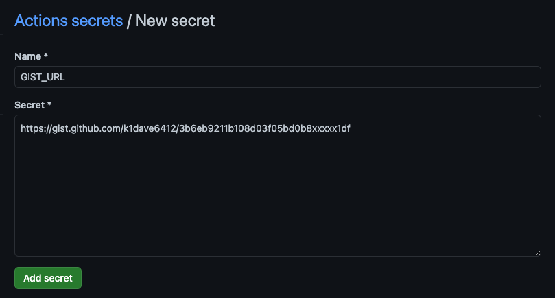
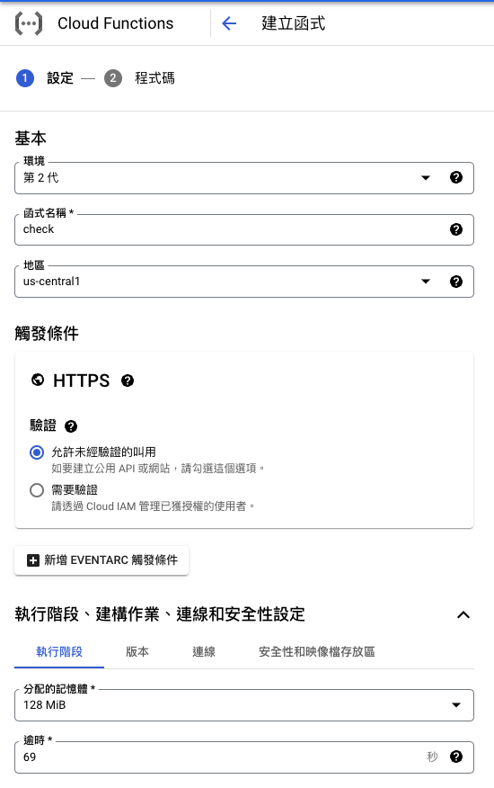
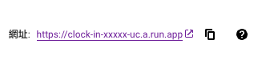
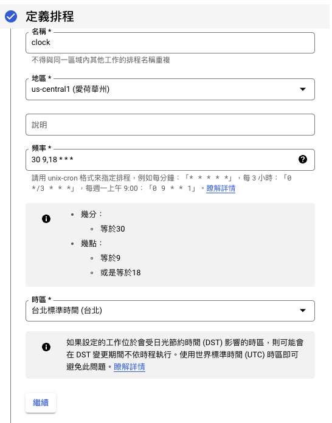

## 不想要手動打開 App 打卡

用 [Playwright](https://playwright.dev/) 加上 Github Action 來實現吧！

## 1. Fork 我已經寫好的 [Repo](https://github.com/k1dave6412/104ClockIn)

## 2. Clone 下來，並安裝必要套件

```bash
pip3 install -r requirements.txt

// 安裝瀏覽器
// Windows
PLAYWRIGHT_BROWSERS_PATH=%USERPROFILE%\AppData\Local\ms-playwright python -m playwright install

// Mac
PLAYWRIGHT_BROWSERS_PATH=~/Library/Caches/ms-playwright python3 -m playwright install

// Linux
PLAYWRIGHT_BROWSERS_PATH=$HOME/pw-browsers python3 -m playwright install
```

## 4. 登入並儲存 Session (效期為一個月)

會自動打開一個瀏覽器，並自動進行登入  
在 60s 內填入 OTP 完成登入  
就會自動關閉

此時會多一個 `cred.json` 會記載登入資訊

```bash
export ac=xxxx
export pwd=xxxx

python3 login.py
```

## 5. 建立一個私人的 gist 將 `cred.json` 貼上，並設定在 Action Secret

1. 前往 [Github Gist](https://gist.github.com/)
2. 點擊右上角進行新增
3. 新增後，複製 gist url
4. 新增 Action Secret `GIST_URL`
5. 觸發 Action 即成功

> 建立 gist 時選 **Create secret gist**，檔名為 `cred.json`，內容貼上剛剛產生的 cookie JSON。（原截圖含 session cookie，已移除）



---

接下來進行自動打卡的設定

## 6. 設定 Cloud Function

- 允許未經允許的叫用
- 128MB
- 貼上以下程式碼



```python title="main.py"
import functions_framework
import httpx

@functions_framework.http
def clock(request):
    request_json = request.get_json(silent=True)
    token = request_json["payload"]["token"]
    url = request_json["payload"]["url"]

    headers = {"Authorization": f"Bearer {token}"}
    resp = httpx.post(url, json={"ref": "main"}, headers=headers)

    if resp.status_code >= 400:
        return resp.text
    return str(resp.status_code)
```

```plain title="requirements.txt"
functions-framework==3.*
httpx
```

## 7. 設定 Cloud Scheduler

1. 複製 Cloud Funcation 網址
   

2. 設定 Cloud Scheduler 基本資料
   圖中頻率為 每日早上 9 點半與晚上 6 點半打卡
   
3. 設定 請求內容
* token 為 Github Personal Token  
需有執行 workflow 權限
* url 為 workflow 觸發的網址
參考文件取得 - [Gihub - Create a workflow dispatch event](https://docs.github.com/en/rest/actions/workflows?apiVersion=2022-11-28#create-a-workflow-dispatch-event)
```json {3,4} title="payload"
{
  "payload": {
    "token": "ghp_xxxxxxxxxxxxxxxxxxxxxxxxxxxx",
    "url": "https://api.github.com/repos/k1dave6412/104ClockIn/actions/workflows/42459444/dispatches"
  }
}
```

> 在「內文」貼上上面的 payload，記得把 `token` 換成自己的 GitHub Personal Token。（原截圖含 token，已移除）

## 常見問題

### 沒有抓到瀏覽器

```
╔════════════════════════════════════════════════════════════╗
║ Looks like Playwright was just installed or updated.       ║
║ Please run the following command to download new browsers: ║
║                                                            ║
║     playwright install                                     ║
║                                                            ║
║ <3 Playwright Team                                         ║
╚════════════════════════════════════════════════════════════╝
```

#### 原因

沒有安裝必要的測試瀏覽器

#### 解法

執行 `playwright install` 或參考步驟 2

## 參考資料

- [Playwright](https://playwright.dev/)
- [Playwright - Browsers](https://playwright.dev/python/docs/browsers)
- [Gihub - Creating a personal access token](https://docs.github.com/en/authentication/keeping-your-account-and-data-secure/creating-a-personal-access-token)
- [Gihub - Create a workflow dispatch event](https://docs.github.com/en/rest/actions/workflows?apiVersion=2022-11-28#create-a-workflow-dispatch-event)
