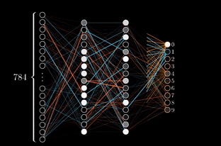

## What？

**反向傳播（ Backpropagation ）是什麼？**

反向傳播是一種用於訓練人工神經網路的演算法。它的核心在於透過計算[Loss Function](/docs/notes/loss-function)（ loss function ）的梯度，逐層更新神經網路中的權重（ weights ），以最小化預測誤差。

簡單來說，反向傳播是「教」神經網路如何調整自己，是機器學習中不可或缺的一部分。就像你在玩射飛鏢，飛鏢偏離靶心時，你會根據偏差調整你的姿勢，反向傳播的概念也類似：根據模型的錯誤去「修正」它。

---

## Who？

**誰使用、誰受影響？**

主要使用者包括：
1. **資料科學家**：用來訓練深度學習模型，例如影像分類、語音辨識等。
2. **機器學習工程師**：負責設計並優化模型架構。
3. **研究人員**：開發新型態演算法或改進現有技術。
4. **產品工程師**：將深度學習應用到實際產品中，例如推薦系統或自動駕駛。

受影響的對象則是所有依賴模型預測結果的系統或服務，例如你的手機人臉辨識功能或 Netflix 的電影推薦。

---

## When？

**什麼時間點會用到？**

反向傳播通常出現在以下情境：
1. 訓練階段：例如，你在建立一個圖像分類模型時，需要透過反向傳播不斷調整權重，使模型能準確判斷圖片內容。
2. 調參階段：當你嘗試不同[超參數](/docs/notes/hyperparameters)（ hyperparameters ）組合時，反向傳播是驗證每個組合效果的重要工具。
3. 模型更新階段：如果系統需要定期更新以適應新資料，例如股票預測模型，就會重新執行反向傳播。

---

## Where？

**出現在架構哪個部分？**

反向傳播主要作用於人工神經網路中的 **隱藏層（ hidden layers ）和輸出層（ output layer ）**。以下是它的位置：
1. 前向運算（ Forward Pass ）後，用於計算損失值與梯度。
2. 透過[梯度下降](/docs/notes/gradient-descent)法（ Gradient Descent ）更新每一層的權重和偏置值（ bias ）。

舉例來說，在 [ResNet](/docs/notes/resnet) 或 [Transformer](/docs/notes/transformer) 等深度學習架構中，反向傳播會遍布整個網路內部，用來調整所有連接層。

---

## Why？

**解決什麼問題？**

反向傳播解決了如何有效率地將預測錯誤「回饋」到神經網路的問題。如果沒有它，我們無法找到最佳化權重的方法，也無法讓深度學習模型準確地完成任務。

具體而言，它幫助我們：
1. 最小化損失函數，使預測結果更符合真實標籤。
2. 自動且高效地調整多層神經網路中的成千上萬個參數，而不需要人工介入。
3. 提升深度學習應用範圍，如 [NLP](/docs/notes/nlp) 、 [Computer Vision](/docs/notes/computer-vision) 等領域。

比喻一下，這就像 GPS 導航一樣，不僅告訴你目前的位置，也指引你最短路徑抵達目的地。

---

## How？

### 🛠️ 建立階段

建立一個基於反向傳播的訓練流程一般包含以下步驟：

1. 初始化權重與偏置值：
   - 通常使用隨機初始化以打破對稱性，例如 Gaussian Distribution 或 Xavier Initialization 方式。
   
2. 前向運算（ Forward Pass ）：
   - 輸入資料透過各層計算並生成輸出值。
   
3. 計算損失函數：
   - 根據輸出值與真實標籤間的差距，如 Cross-Entropy Loss 或 Mean Squared Error 。

4. 進行梯度運算：
   - 使用鏈式法則計算各層參數對損失函數的梯度值。

5. 更新參數：
   - 使用梯度下降法改變權重與偏置，例如 SGD 、 Adam 。

6. 重複上述步驟直到收斂或達到指定迭代次數。

### 🔍 查詢階段

查詢階段中，其實不直接使用反向傳播，但需要基於訓練好的模型進行推論流程：

1. 前向運算：
   - 將查詢資料通過已訓練好的網路進行推理，得出結果。
   
2. 評估性能指標：
   - 根據[準確性](/docs/notes/accuracy)、 [F1 Score](/docs/notes/f1-score) 等衡量查詢結果表現是否符合需求。

---

## 補充說明

### 📌 範例比較

| 技術／方法      | 特性                           | 適合情境                   |
|-----------------|-------------------------------|---------------------------|
| SGD             | 單批次更新慢但穩定             | 小型資料集                |
| Adam            | 動態調節學習率快收斂          | 深層結構／大型資料集       |

---

### 🧠 延伸／常見誤解

- **誤解 1：只需正確設計前向運算，就能得到好模型。**
  正確設計前向運算很重要，但如果沒有良好的後續梯度計算與參數更新，模型可能無法收斂甚至完全失效。

- **誤解 2：越多隱藏層越好。**
  雖然增加隱藏層可以提高表達能力，但同時也更容易陷入梯度消失問題，因此要搭配技術如 Batch Normalization 或 Residual Connections 。

- **延伸概念：強化式學習中的「策略梯度」**
  雖然策略梯度看似與 Backpropagation 不相干，但兩者都涉及利用損失函數回饋來改進目標，所以可以視為不同應用場景下相似思維的一種延伸。
